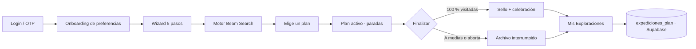
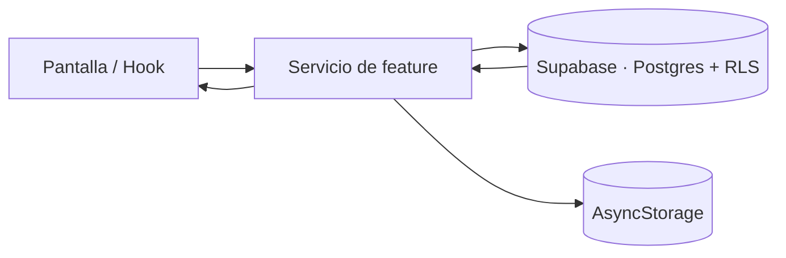

<p align="center">
  
</p>

<h1 align="center">Chaski — Boleto de Experiencias</h1>

<p align="center">
  <em>Serie AX · Planifica recorridos culturales por Lima y archiva cada expedición como un boleto sellado.</em>
</p>

<p align="center">
  <a href="https://img.shields.io/badge/Expo_SDK-57-0288ED?style=flat-square"></a>
  <a href="https://img.shields.io/badge/React_Native-0.86.3-61DAEB?style=flat-square"></a>
  <a href="https://img.shields.io/badge/TypeScript-6.0-3178C6?style=flat-square"></a>
  <a href="https://img.shields.io/badge/Supabase-2.115-3ECF8E?style=flat-square"></a>
  <a href="#calidad"></a>
  <a href="./LICENSE"></a>
</p>

---

## Sobre Chaski

**Chaski** es una app móvil para planificar salidas urbanas por **Lima Metropolitana**. Le dices cuándo sales, hasta cuándo tienes, cuánto quieres gastar, cómo te mueves y qué te interesa; Chaski arma recorridos realizables con esos límites y te acompaña mientras los cumples.

### El problema que resuelve

Organizar una salida en Lima suele exigir consultar varias fuentes por separado: qué lugares valen la pena, sus horarios, cuánto tarda el traslado y si todo cabe en tu tiempo y presupuesto. Los mapas y las redes ofrecen datos sueltos, pero la decisión —**qué visitar, en qué orden y si el recorrido completo es viable**— queda en tus manos.

Chaski hace ese cruce por ti.

### Cómo funciona

| Tú defines | Chaski calcula | Recibes |
|---|---|---|
| Ubicación de inicio y retorno | Filtro geoespacial del catálogo patrimonial | Hasta 3 planes: **íntima, equilibrada y exploradora** |
| Ventana horaria y presupuesto | Matriz OD de tiempos de traslado | Itinerario ordenado con costos, distancias y horarios |
| 1–3 intereses y modalidad de movilidad | Beam Search + puntuación multicriterio | Plan activo con check-in de paradas e historial sellado |

### ¿Para quién?

Estudiantes, jóvenes profesionales, parejas y familias que quieren sacarle provecho a un día en la ciudad sin tener que armar el recorrido a mano.

---

## Capturas

> _Próximamente — capturas de las pantallas principales._

| Inicio | Wizard | Resultados |
|---|---|---|
| Plan activo | Completado | Mis Exploraciones |

---

## Funcionalidades

**🔍 Explora**
- Catálogo patrimonial de Lima con fotos, costos y horarios reales.
- Detalle de cada lugar con navegación a mapas nativos del dispositivo.

**🧭 Planifica**
- Asistente de 5 pasos: ubicación, tiempo, presupuesto, intereses y movilidad.
- Motor de planes con **Beam Search** y scoring con diversidad (Jaccard) — hasta 3 variantes: íntima, equilibrada y exploradora.
- Registro de la solicitud en Supabase con deduplicación e idempotencia.

**🎫 Vive el recorrido**
- Plan activo con paradas ordenadas, marcado de visitadas y navegación externa.
- Estados honestos: **COMPLETADA**, **PARCIAL** o **ABANDONADA** según el progreso real.
- Celebración one-shot con confeti textil andino solo al completar el 100 %.

**📦 Archiva**
- «Mis Exploraciones»: boletos culturales con folio, sello y itinerario ejecutado.
- Historial sincronizado en Supabase (`solicitudes_plan` + `expediciones_plan`), con snapshot del plan y paradas visitadas.
- Perfil con avatar, preferencias y recordatorios de viaje.

**🛡️ Administra** (Panel de Intendencia)
- Padrón de exploradores con métricas, búsqueda y filtros por rol/estado.
- Activación y suspensión de cuentas con protecciones server-side (RLS + RPC).

---

## El recorrido del usuario



---

## Stack

| Capa | Tecnología |
|---|---|
| Runtime móvil | Expo SDK 57 · React Native 0.86 · React 19 |
| Navegación | Expo Router (rutas = pantallas en `src/app/`) |
| Backend | Supabase: Auth (OTP), Postgres con RLS, Storage |
| Mapas | react-native-maps + capa raster OpenStreetMap en Expo Go |
| Animaciones | react-native-reanimated 4 (confeti de celebración) |
| Persistencia local | AsyncStorage (sesión, plan activo y progreso) |
| Calidad | TypeScript estricto · ESLint (config-expo) · Vitest |

---

## Arquitectura

Organización **por features**: cada dominio concentra pantallas, componentes, servicios, hooks, interfaces y tests. Las rutas de `src/app/` son delgadas re-exports.

```
src/
├── app/                  # Rutas Expo Router
│   ├── (tabs)/           # Inicio · Mis Exploraciones · Perfil
│   ├── wizard/           # ubicacion · mapa · tiempo · presupuesto · intereses · movilidad
│   ├── plan/             # buscando · resultados · detalle · activo · completado
│   └── admin · verify-otp · preferences · places …
├── features/
│   ├── auth/             # OTP, recuperación, perfil y avatar
│   ├── wizard/           # contexto y UI del asistente
│   ├── plan-engine/      # Beam Search y scoring de rutas
│   ├── plans/            # ciclo de vida del plan e historial (Supabase)
│   ├── places/           # catálogo patrimonial
│   ├── preferences/      # onboarding y preferencias
│   └── admin/            # Panel de Intendencia
├── shared/               # utilidades y componentes comunes
└── lib/supabase.ts       # cliente Supabase (único punto de acceso)

supabase/
├── migrations/           # esquema versionado (6 migraciones)
└── tests/                # verificaciones SQL
docs/                     # centro de documentación técnica
```

**Flujo de datos:**



Cada usuario solo ve y modifica sus filas: las políticas RLS usan `auth.uid()` en todas las tablas de negocio.

---

## Puesta en marcha

**Requisitos:** Node.js 20+ · npm 10+ · Expo Go (Android/iOS) o emulador AVD.

```bash
# 1. Dependencias
npm install

# 2. Variables de entorno (credenciales del proyecto, pide al equipo)
copy .env.template .env
#    EXPO_PUBLIC_SUPABASE_URL=https://<project-ref>.supabase.co
#    EXPO_PUBLIC_SUPABASE_KEY=<publishable key>

# 3. Arrancar Metro
npm start
```

- **Emulador:** `npm run android` o `npm run ios`.
- **Dispositivo físico:** escanea el QR con Expo Go (misma red Wi-Fi). Si la red es hostil, usa túnel: `npm start -- --tunnel`.
- **Bundle viejo o sospecha de caché:** `npm start -- --clear`.
- **Base de datos:** ejecuta las migraciones de `supabase/migrations/` en tu proyecto Supabase (en orden cronológico). La más reciente (`20261015103000_expediciones_plan.sql`) habilita el historial de expediciones.

> En Expo Go, los mapas usan una capa raster de OpenStreetMap sin API key. La key de Google Maps solo es necesaria en un Development Build propio (ver `.env.template`).

---

## Calidad

| Comando | Para qué |
|---|---|
| `npm run lint` | ESLint — debe terminar sin errores |
| `npx tsc --noEmit` | Chequeo de tipos estricto |
| `npm test` | Suite Vitest completa — **752 pruebas en verde** |
| `npm run test:watch` | Vitest en modo watch durante el desarrollo |

Convenciones: identificadores en inglés, textos visibles en español, exportes explícitos en barrels y tests por feature bajo `__tests__/`.

---

## Documentación

El centro completo vive en [`docs/`](./docs/README.md): visión de producto, requisitos funcionales (RF), reglas de negocio, casos de uso, modelo de datos, arquitectura y el algoritmo de Beam Search — todo con diagramas Mermaid y matriz de trazabilidad.

---

## En camino

- Expediciones **EN_CURSO**: estado en vivo del recorrido y progreso sincronizado mientras se camina.
- «Limpiar historial» sincronizado entre dispositivos.

---

<p align="center">
  <sub><strong>Chaski · Serie AX</strong> — Grupo 3 · Universidad Tecnológica del Perú (UTP)</sub><br/>
  <sub>Desarrollado con Expo y Supabase · <a href="./docs/README.md">Documentación técnica</a></sub>
</p>
