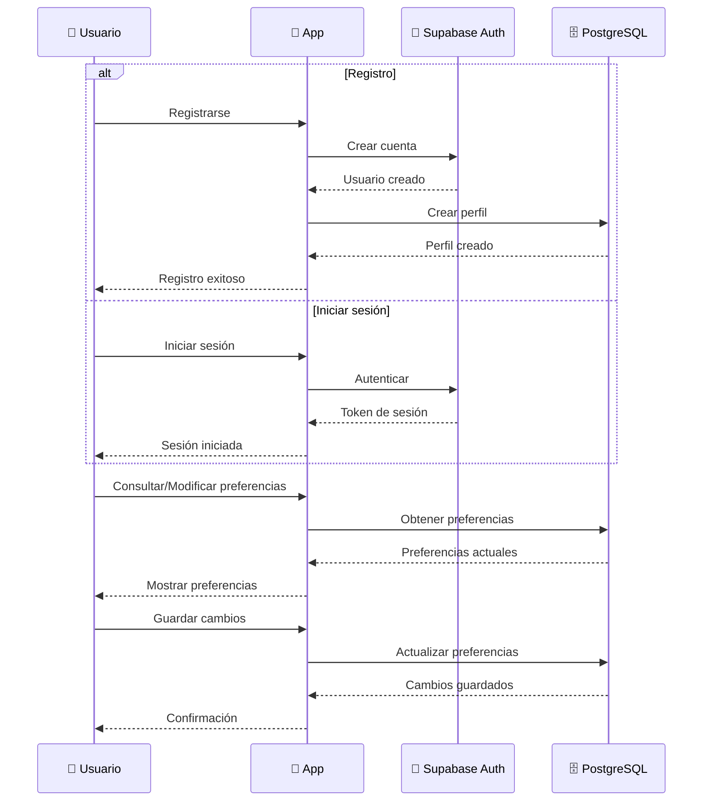
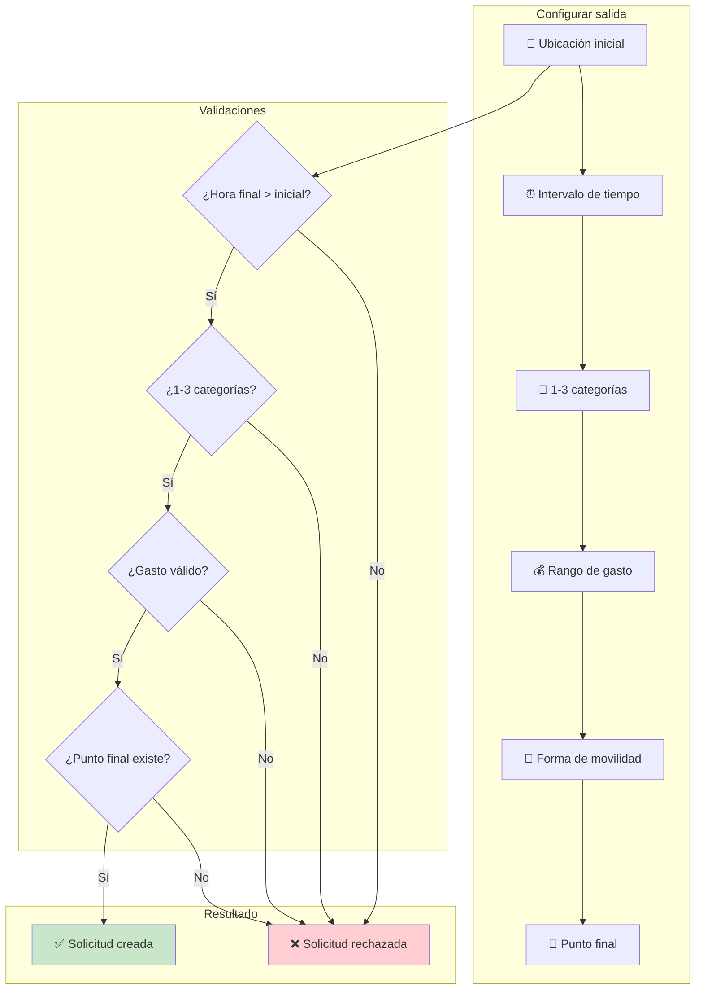
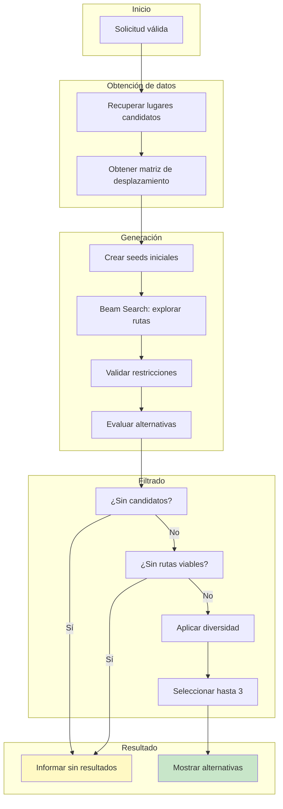
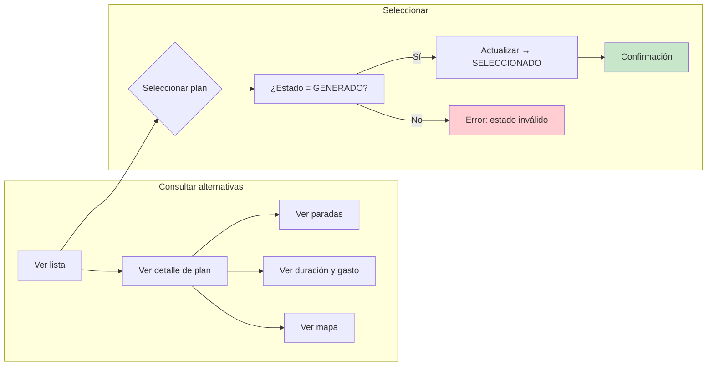
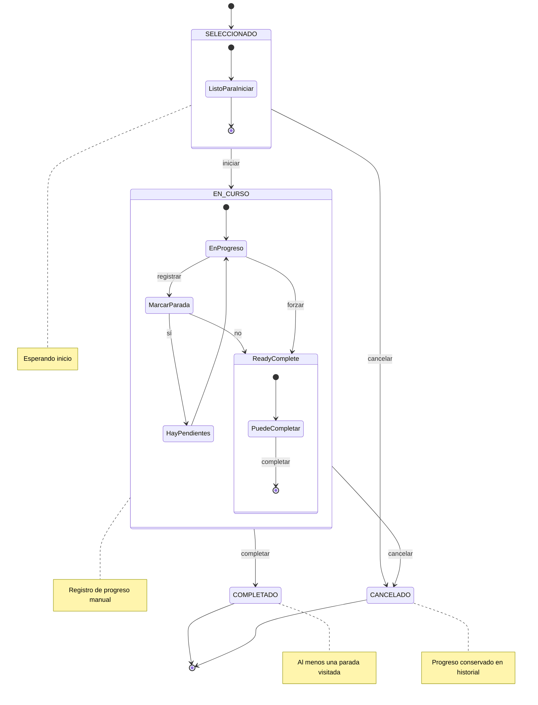
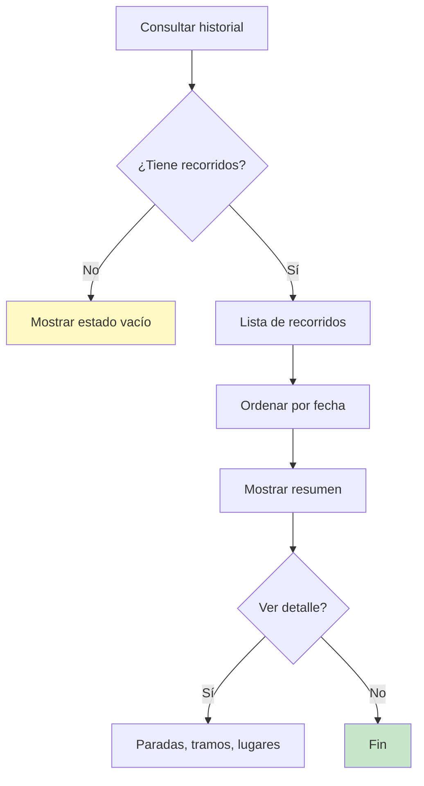

 # Casos de uso — Chaski

## 1. Propósito

Este documento describe los principales casos de uso de Chaski para su primera versión.

Los casos de uso representan las interacciones principales entre los actores y el sistema y se encuentran relacionados con los requisitos funcionales definidos en [`requisitos-funcionales.md`](../02-requisitos/requisitos-funcionales.md).

---

## 2. Actores

| Actor | Descripción |
|---|---|
| **Usuario** | Persona registrada que configura salidas, genera alternativas, selecciona planes, registra progreso y consulta historial |
| **Administrador** | Usuario con permisos para gestionar lugares, categorías, horarios y consultar reportes |

---

## 3. Resumen de casos de uso

```mermaid
graph TB
    subgraph Actores["Actores"]
        USUARIO["👤 Usuario"]
        ADMIN["👨‍💼 Administrador"]
    end

    subgraph CU_Usuario["Casos de uso — Usuario"]
        CU01["CU01: Gestionar cuenta y preferencias"]
        CU02["CU02: Crear solicitud de plan"]
        CU03["CU03: Generar alternativas"]
        CU04["CU04: Consultar y seleccionar plan"]
        CU05["CU05: Gestionar recorrido activo"]
        CU06["CU06: Consultar historial"]
    end

    subgraph CU_Admin["Casos de uso — Administrador"]
        CU07["CU07: Gestionar lugares"]
        CU08["CU08: Gestionar categorías y etiquetas"]
        CU09["CU09: Consultar reportes"]
        CU10["CU10: Administrar usuarios"]
        CU11["CU11: Supervisar planes y expediciones"]
        CU12["CU12: Administrar fotografías de destinos"]
        CU13["CU13: Auditar las acciones de intendencia"]
    end

    USUARIO --> CU01
    USUARIO --> CU02
    USUARIO --> CU03
    USUARIO --> CU04
    USUARIO --> CU05
    USUARIO --> CU06

    ADMIN --> CU07
    ADMIN --> CU08
    ADMIN --> CU09
    ADMIN --> CU10
    ADMIN --> CU11
    ADMIN --> CU12
    ADMIN --> CU13

    style USUARIO fill:#bbdefb,stroke:#1976d2
    style ADMIN fill:#c8e6c9,stroke:#388e3c
    style CU_Usuario fill:#e3f2fd,stroke:#1976d2
    style CU_Admin fill:#e8f5e9,stroke:#388e3c
```

| ID | Caso de uso | Actor | Descripción |
|---|---|---|---|
| CU01 | Gestionar cuenta y preferencias | Usuario | Registro, login, perfil, preferencias |
| CU02 | Crear solicitud de plan | Usuario | Configurar condiciones de una salida |
| CU03 | Generar alternativas | Usuario | Obtener hasta 3 planes compatibles |
| CU04 | Consultar y seleccionar plan | Usuario | Ver alternativas y elegir una |
| CU05 | Gestionar recorrido activo | Usuario | Iniciar, marcar paradas, completar, cancelar |
| CU06 | Consultar historial | Usuario | Ver recorridos realizados |
| CU07 | Gestionar lugares | Administrador | CRUD de lugares del catálogo |
| CU08 | Gestionar categorías y etiquetas | Administrador | Administrartaxonomía del catálogo |
| CU09 | Consultar reportes | Administrador | Ver estadísticas del sistema |
| CU10 | Administrar usuarios | Administrador | Consultar el padrón, editar datos y rol, dar de baja con anonimización |
| CU11 | Supervisar planes y expediciones | Administrador | Revisar y eliminar solicitudes y expediciones de todos los usuarios |
| CU12 | Administrar fotografías de destinos | Administrador | Subir fotos desde cámara o galería, marcar portada y eliminar |
| CU13 | Auditar las acciones de intendencia | Administrador | Historial automático de cambios administrativos y métricas de uso |

---

## 4. CU01 — Gestionar cuenta y preferencias

### Precondiciones

- Para consultar o modificar preferencias, el usuario deberá encontrarse autenticado.

### Flujos alternativos

- **Registro con correo existente**: el sistema rechaza el registro e informa al usuario.
- **Datos inválidos**: el sistema no guarda los cambios y solicita corrección.

---

## 5. CU02 — Crear solicitud de plan

### Campos requeridos

| Campo | Tipo | Validación |
|---|---|---|
| Ubicación inicial | GeoPoint | Requerido |
| Fecha/hora inicio | Timestamp | Requerido |
| Fecha/hora fin | Timestamp | > fecha inicio |
| Categorías | Array | 1 a 3 elementos |
| Gasto min/max | Decimal | ≥ 0, min ≤ max |
| Movilidad | Enum | CAMINAR, BICICLETA, AUTO, TRANSPORTE_PUBLICO |
| Tipo punto final | Enum | REGRESAR_INICIO, ULTIMA_PARADA, OTRA_UBICACION |

---

## 6. CU03 — Generar alternativas

### Parámetros del algoritmo

| Parámetro | Valor | Descripción |
|---|---|---|
| `MAX_INITIAL_SEEDS` | 5 | Seeds iniciales como puntos de partida |
| `BEAM_WIDTH` | 3 | Rutas parciales conservadas por nivel |
| `MIN_STOPS` | 1 | Paradas mínimas en un plan |
| `MAX_STOPS` | 4 | Paradas máximas en un plan |
| `MAX_RESULTS` | 3 | Resultados finales máximo |

---

## 7. CU04 — Consultar y seleccionar plan

---

## 8. CU05 — Gestionar recorrido activo

### Restricciones

- Solo un recorrido activo por usuario a la vez.
- Para completar: al menos una parada `VISITADA`, sin `PENDIENTE`.
- Cancelar está permitido desde `SELECCIONADO` o `EN_CURSO`.

---

## 9. CU06 — Consultar historial

> Los planes `GENERADO` sin seleccionar **no** forman parte del historial.

---

## 10. CU07 — CU09 — Casos del administrador

```mermaid
flowchart TB
    subgraph CU07["CU07: Gestionar lugares"]
        A1[Registrar lugar] --> A2[¿Datos válidos?]
        A2 -->|Sí| A3[Guardar lugar]
        A2 -->|No| A4[Mostrar errores]
        A3 --> A5[Gestionar horarios]
        A5 --> A6[Activar/Desactivar]
    end

    subgraph CU08["CU08: Gestionar categorías"]
        B1[Crear categoría] --> B2[¿Nombre único?]
        B2 -->|Sí| B3[Guardar]
        B2 -->|No| B4[Error]
        B3 --> B5[Crear etiqueta]
        B5 --> B6[Asociar a lugares]
    end

    subgraph CU09["Consultar reportes"]
        C1[Seleccionar tipo] --> C2{Lugares más visitados}
        C2 --> C3[Planes por período]
        C3 --> C4[Duración promedio]
        C4 --> C5[Reporte consolidado]
    end

    style A3 fill:#c8e6c9
    style B3 fill:#c8e6c9
    style C5 fill:#c8e6c9
```

---

## 10.1. CU10 — CU13 — Casos del panel de intendencia

Estos casos corresponden a la administración institucional: quién puede ver y modificar la información de todas las cuentas. Se apoyan en la regla de negocio de que solo una cuenta con rol `ADMIN` y estado activo puede ejecutarlos, y esa verificación ocurre en la base de datos, no en la aplicación.

```mermaid
flowchart TB
    subgraph CU10["CU10: Administrar usuarios"]
        D1[Abrir padrón] --> D2[Buscar o filtrar]
        D2 --> D3[Elegir cuenta]
        D3 --> D4{Acción}
        D4 -->|Editar| D5[Cambiar nombre o rol]
        D4 -->|Baja| D6[Confirmar anonimización]
        D5 --> D7[Guardar cambios]
        D6 --> D7
    end

    subgraph CU11["CU11: Supervisar planes y expediciones"]
        E1[Elegir pestaña] --> E2[Solicitudes o expediciones]
        E2 --> E3[Buscar por usuario]
        E3 --> E4[Eliminar registro]
        E4 --> E5[Confirmar]
    end

    subgraph CU12["CU12: Administrar fotografías"]
        F1[Elegir destino] --> F2{Cámara o galería}
        F2 --> F3[Validar formato y tamaño]
        F3 --> F4[Subir y registrar]
        F4 --> F5[Marcar portada o eliminar]
    end

    subgraph CU13["CU13: Auditar acciones"]
        G1[Abrir auditoría] --> G2[Métricas de uso]
        G2 --> G3[Historial paginado]
        G3 --> G4[Identificar autor y cambio]
    end

    style D7 fill:#c8e6c9
    style E5 fill:#c8e6c9
    style F5 fill:#c8e6c9
    style G4 fill:#c8e6c9
```

| Caso de uso | Actor | Resultado esperado |
|---|---|---|
| CU10 | Administrador | La cuenta queda con el nombre, rol y estado indicados, o anonimizada y sin acceso |
| CU11 | Administrador | La solicitud o la expedición deja de existir, junto con sus registros dependientes |
| CU12 | Administrador | La fotografía queda almacenada y asociada al destino, o eliminada del almacenamiento |
| CU13 | Administrador | Se conoce qué hizo cada administrador y cómo se está usando la aplicación |

La auditoría de CU13 se llena por disparadores de la base de datos: cuando un administrador modifica una cuenta o elimina un plan, el registro aparece sin que la aplicación tenga que escribirlo. Esto garantiza que un cambio no pueda quedar sin rastro aunque se ejecute por otra vía.

---

## 11. Tabla resumen de estados

| Entidad | Estados posibles |
|---|---|
| **Plan** | GENERADO → SELECCIONADO → EN_CURSO → COMPLETADO / CANCELADO |
| **Parada** | PENDIENTE → VISITADA / OMITIDA |
| **Lugar** | ACTIVO / INACTIVO |
| **Usuario** | ACTIVO / INACTIVO |

---

## 12. Requisitos y reglas relacionados

| CU | Requisitos | Reglas de negocio |
|---|---|---|
| CU01 | RF01, RF02, RF03, RF32 | USR-01 a USR-04 |
| CU02 | RF04, RF05 | SOL-01 a SOL-08 |
| CU03 | RF06, RF07, RF08, RF33 | LUG-01 a LUG-05, GEN-01 a GEN-10 |
| CU04 | RF09, RF10, RF11, RF12 | PLA-01, PLA-02, EVA-01 a EVA-13 |
| CU05 | RF13, RF14, RF15, RF16, RF30, RF31 | PLA-03 a PLA-08, PAR-01 a PAR-06 |
| CU06 | RF17 | HIS-01 a HIS-04 |
| CU07 | RF18 | LUG-01 a LUG-05 |
| CU08 | RF19 | CAT-01, ETI-01 |
| CU09 | RF20 | — |
| CU10 | RF21, RF22, RF23 | USR-02, USR-05 |
| CU11 | RF24, RF25 | PLA-01, PLA-02 |
| CU12 | RF26, RF27 | LUG-06, LUG-07 |
| CU13 | RF28, RF29 | ADM-01, ADM-02 |
